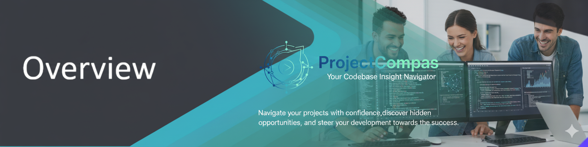

# ProjectCompass

**Analysis catalog, execution engine, and data exploration platform.**

> **Before deployment:** the current implementation has important authentication, container packaging and recovery limitations. Read [Security and current limitations](docs/kubernetes_console.html#security-and-current-limitations) before exposing the application or running workloads.
>
> **Full Documentation Portal:** Open [`index.html`](index.html) for the complete interactive **Nautical Command Deck** documentation suite (covering [Platform Overview](docs/overview.html), [User Guide](docs/user_guide.html), [Architecture](docs/architecture.html), [Core Classes](docs/core_classes.html), [Templates](docs/templates.html), [k0s Setup](docs/k0s_setup.html), [Kubernetes Console](docs/kubernetes_console.html), [Custom Worker Library](docs/worker_library.html), [API & CLI Reference](docs/routes.html), [Configuration](docs/configuration.html), and [Docker](docs/docker.html)).



ProjectCompass is a Python-based tool for teams that produce data analyses. It solves three problems that emerge after the analytical work is done:

1. **Organization** — a tag-based catalog of all analyses with metadata, documentation, and version tracking
2. **Execution** — a unified environment to run structured analyses consistently, with scheduling
3. **Exploration** — SQL queries on local datasets via DuckDB, with visualization and LLM-powered chat

---

## Features

| Feature | Description |
|---------|-------------|
| 📂 **Catalog** | Tag-based analysis repository with search, filter, pagination, and full-text search (FTS5) |
| 🔍 **Data Explorer** | SQL queries on CSV/SQLite via DuckDB with data lineage tracking |
| 📊 **RAWGraphs Visualization** | Custom chart builder with 30+ chart types, drag-and-drop mapping, visual options, SVG/PNG export |
| 🔧 **Pipeline Builder** | Visual ML pipeline designer with DSL syntax (`>>`) and 4 pre-built templates |
| 🧠 **scomp-link Integration** | 6 ML blocks (Drift, Explainability, Fairness, Tuning, Validation, NLP) + 7 Report blocks |
| ⚙️ **Execution Engine** | Run structured analyses with real-time SSE streaming, progress bar, and abort capability |
| 📜 **Execution History** | Full history with status badges, filtering, and detailed logs |
| 🔄 **Pipeline Versioning** | Every save creates a version; restore to any previous state |
| ⏰ **Scheduler** | Schedule analyses with cron/interval triggers (APScheduler + SQLite persistence) |
| 🤖 **AI Chat** | Ask questions about your data in natural language (Mithril — multi-model: Gemini, OpenAI, Anthropic, Groq, local GGUF) |
| 🧠 **RAG per Analysis** | Per-project retrieval-augmented generation with code-aware chunking, hybrid search (dense + BM25), LLM reranking, guardrails, and source provenance |
| 🔗 **REST API** | JSON endpoints with Bearer token authentication for external integrations |
| ☸️ **Kubernetes Console** | Read-only workers, Python flows, sequential chains, Job runs and logs |
| 💻 **External CLI** | Control flows, chains, runs and schedules using HTTP Basic or Bearer authentication |
| 👥 **Multi-User RBAC** | Admin, editor, viewer roles with user management |
| 💬 **Comments** | Real-time HTMX comments on analyses for team collaboration |
| 🔔 **Webhooks** | HMAC-SHA256 signed payloads for external system integration |
| 📊 **Observability** | Admin metrics dashboard with Chart.js visualizations |
| 🌙 **Dark Mode** | Toggle with localStorage persistence |
| 📦 **Export/Import** | Package analyses as ZIP for sharing and backup |
| 🐳 **Docker** | One-command deployment with Mithril multi-model LLM backend |

---

## Quick Start with Docker

The public image can be started with the Compose file below. Review the [deployment limitations](docs/kubernetes_console.html#security-and-current-limitations), configure credentials, and mount `/app/data` for persistent state before relying on it:

```bash
# Download the compose file
curl -O https://raw.githubusercontent.com/GiacomoSaccaggi/ProjectCompass/main/docker-compose.public.yml

# Start
docker compose -f docker-compose.public.yml up -d

# Open browser
open http://localhost:8080
```

To enable AI chat, configure Mithril API keys in a `.env` file next to the compose file:
```bash
echo "MITHRIL_KEY_GEMINI=your-gemini-key" >> .env
# Or use any supported provider: MITHRIL_KEY_OPENAI, MITHRIL_KEY_ANTHROPIC, MITHRIL_KEY_GROQ
```

To update to the latest version:
```bash
docker compose -f docker-compose.public.yml pull
docker compose -f docker-compose.public.yml up -d
```

---

## Local Development

The current dependency specification includes a machine-local package path; it must be changed to an approved portable package source before `uv sync` can work on another machine. Review `.env` and configure credentials before starting the application.

```bash
git clone https://github.com/GiacomoSaccaggi/ProjectCompass.git
cd ProjectCompass
uv sync

cp .env.example .env
# Edit .env with your settings

uv run python app.py
```

The app is available at `http://127.0.0.1:5000`

### Running Tests

```bash
uv run pytest -v
```

The default suite excludes live-cluster tests. See [testing and troubleshooting](docs/k0s_setup.html#testing-and-troubleshooting) for the optional live marker and its scope.

### Linting

```bash
uv run ruff check .
uv run ruff check --fix .  # auto-fix
```

---

## Docker (Development)

The default Compose file references a published image; a local build can be enabled in the file after the packaging issue described in the [deployment limitations](docs/kubernetes_console.html#security-and-current-limitations) is addressed:

```bash
docker compose up -d
```

This uses `docker-compose.yml` and may also load its development override. Review port mappings, the fixed container entrypoint and `/app/data` persistence as described in the operations guide.

See [DOCKER.md](DOCKER.md) for volumes, environment variables, health checks, and production settings.

---

## Workers & Execution

ProjectCompass is the orchestrator and UI: structured analyses and Flow steps run as isolated Kubernetes Jobs on k0s workers, not as user scripts inside the web application container. The cloud-agnostic `WorkerProvider` abstraction can use existing Ready nodes, provision Docker k0s worker containers for a local/demo cluster, or delegate worker lifecycle to configured external scripts.

### Docker k0s workers

The Docker provider requires Docker CLI access and the host Docker socket. The `docker-compose.k0s.yml` overlay mounts `/var/run/docker.sock` and a read-only worker join token. Generate the token on the k0s controller and start the overlay:

```bash
mkdir -p data
sudo k0s token create --role=worker > ./data/k0s-worker.token
chmod 600 ./data/k0s-worker.token
K0S_WORKER_TOKEN_FILE=./data/k0s-worker.token \
  docker compose -f docker-compose.yml -f docker-compose.k0s.yml up -d
```

The overlay passes the token as `PC_K0S_TOKEN_FILE`. Alternatively, configure `workers.docker.join_token_file` or `PC_K0S_JOIN_TOKEN`; `workers.docker.controller_container` can be used to create a token with `docker exec` when the controller is a container. The configured token must identify an API endpoint reachable from the worker container network.

Docker worker settings live under `workers` in `projectcompass.yaml` (see [`projectcompass.example.yaml`](projectcompass.example.yaml)). `workers.docker.network` defaults to `bridge`, which permits multiple managed workers; `host` networking is available but limited to one managed worker. Workers use `workers.docker.ready_timeout_seconds` (default `120`) to wait for Kubernetes readiness. `workers.auto_provision` enables provisioning and `workers.auto_cleanup` releases managed Docker or external workers only when no Flow or FlowChain is active. The old `workers.docker.auto_cleanup` key remains a compatibility alias.

For infrastructure-managed workers, set `workers.provider: external` and configure `ensure_script`, `release_script`, and optionally `status_script`. Scripts receive worker count or node names through `PC_WORKER_COUNT` and `PC_WORKER_NODES`; their output is parsed as JSON or newline-delimited node names. Compass does not include provider-specific infrastructure integrations.

### Connectors and data/artifact limits

Pipeline Builder connectors are configured in the top-level `connectors:` list. Each connector defines a `name`, `description`, container `image`, `builtin` flag, and typed `parameters`; a `select` parameter can use `source: connections` to populate saved connection names. Every saved step runs as its own Flow in a sequential FlowChain. For example:

```yaml
connectors:
  - name: python_script
    description: Run Python code
    builtin: true
    image: python:3.12-slim
    parameters:
      code: {type: code, required: true}
  - name: team_runner
    description: Run a team container
    image: team-runner:latest
    parameters:
      query: {type: text, required: true}
      connection: {type: select, source: connections}
```

Structured-analysis artifacts are sent inline through Pod logs by default. `PC_ARTIFACT_INLINE_MAX_BYTES` sets the per-file inline threshold (default `5242880`, 5 MiB); base64 log framing adds roughly one-third to the transferred data. Larger artifacts can use `PC_SHARED_ARTIFACT_DIR` only when the same shared volume is mounted into both the worker Job and Compass at that path. ProjectCompass does not provision that volume automatically; without it, artifacts remain inline. Saved CSV datasets mounted through the per-run ConfigMap are limited to `512 KiB` per file and `800 KiB` total; skipped files are recorded as warnings in the run log.

See [DOCKER.md](DOCKER.md) and [k0s setup](docs/k0s_setup.html) for the full setup and networking notes.

---

## Architecture

```
ProjectCompass/
├── app.py                  # Application factory (Flask + APScheduler)
├── config.py               # Configuration from environment
├── logging_config.py       # Unified structured logging
├── basefun.py              # Core ProjectCompass class
├── models.py               # SQLAlchemy models (User, Analysis, Execution, Comment, etc.)
├── blueprints/
│   ├── auth.py             # Authentication (RBAC, sessions, API tokens)
│   ├── catalog.py          # Analysis CRUD, search, filter, scheduling, versioning
│   ├── data.py             # Query runner, data upload, RAWGraphs, lineage
│   ├── agent.py            # LLM chat with sandboxed execution (Mithril backend)
│   ├── rag.py              # RAG index build, status, and management
│   ├── k8s.py              # Worker, flow, Job and chain endpoints
│   └── api.py              # REST API (JSON endpoints)
├── utils/
│   ├── analysis_utils.py   # Analysis, flow and version management
│   ├── k8s_utils.py        # Kubernetes client, workers, Jobs and chains
│   ├── git_utils.py        # Optional analyses synchronization
│   ├── cli_utils.py        # External HTTP client and CLI commands
│   ├── data_utils.py       # DuckDB SQL, file operations
│   ├── html_utils.py       # Template utilities
│   ├── mithril_client.py   # Mithril LLM client (httpx, Ollama-compatible API)
│   ├── chunker.py          # Code-aware document chunking for RAG
│   ├── rag_store.py        # ChromaDB vector store wrapper
│   └── rag_guardrails.py   # RAG input/output validation and prompt builder
├── templates/
│   ├── *.html              # Jinja2 HTML templates with HTMX
│   ├── admin/              # User management, metrics dashboard
│   └── components/         # HTMX partials (toasts, activity feed, search)
├── static/
│   ├── css/
│   │   ├── style.css       # Main styles
│   │   └── dark.css        # Dark mode theme
│   ├── js/                 # JavaScript (command palette, SSE, toasts)
│   └── pipeline_templates/ # Pre-built ML pipeline templates (JSON)
├── tests/                  # pytest test suite
├── k8s/                    # Kubernetes deployment and RBAC manifests
├── scripts/                # External CLI and k0s setup
├── Analyses/               # Analysis storage (file-based)
├── Saved_data/             # Uploaded datasets
├── Saved_queries/          # Saved SQL queries
├── projectcompass.db       # SQLite database (users, executions, comments, audit log)
└── scheduler_jobs.db       # APScheduler job persistence (SQLite)
```

### Tech Stack

- **Backend**: Flask 3.0, Flask-SQLAlchemy, Gunicorn, Python 3.13
- **Database**: SQLite with FTS5 full-text search
- **Data**: DuckDB (in-memory SQL on CSV), pandas
- **Visualization**: RAWGraphs via CDN, Chart.js, Plotly (via scomp-link)
- **ML Pipelines**: scomp-link v2.2.0 (DSL syntax, Optuna tuning, SHAP/LIME explainability)
- **Scheduling**: APScheduler with SQLite persistence
- **AI**: Mithril (multi-model orchestration — Gemini, OpenAI, Anthropic, Groq, local GGUF)
- **RAG**: ChromaDB (vector store), code-aware chunking, hybrid search (dense + BM25), LLM reranking
- **Embeddings**: Local E5-small (sentence-transformers, 384 dims, zero cost) — optional Mithril cloud proxy
- **Frontend**: W3.CSS, HTMX 2.0, Chart.js, jQuery
- **Real-time**: Server-Sent Events (SSE) for execution streaming
- **Security**: RBAC, werkzeug password hashing, API Bearer tokens, HMAC webhooks, AST sandbox
- **CI/CD**: GitHub Actions (ruff + pytest on tags), Docker image auto-published to ghcr.io

---

## Configuration

All configuration is via environment variables (`.env` file):

| Variable | Default | Description |
|----------|---------|-------------|
| `SECRET_KEY` | random | Flask session encryption key |
| `DATABASE_URL` | SQLite under `DATA_DIR` | SQLAlchemy database URI |
| `DATA_DIR` | Project root locally; `/app/data` in the image | Persistent state root |
| `ADMIN_USERNAME` | `admin` | Default admin username |
| `ADMIN_PASSWORD_HASH` | *(empty)* | Werkzeug-hashed password |
| `PORT` | `5000` | Server port |
| `FLASK_DEBUG` | `False` | Debug mode |
| `API_AUTH_TOKEN` | *(empty)* | Optional static Bearer token |
| `USE_GIT_SYNC` | `False` | Optional Git synchronization; see credential warning in the operations guide |
| `MITHRIL_HOST` | `http://localhost:16180` | Mithril LLM endpoint |
| `MITHRIL_EMBED_MODEL` | `gemini-embedding-exp-03-07` | Embedding model for RAG |
| `MITHRIL_RERANK_MODEL` | `gemini-2.5-flash` | Reranking model for RAG |
| `RAG_EMBED_BACKEND` | `local` | Embedding backend: `local` (E5, zero cost) or `mithril` (cloud) |
| `ALLOWED_ORIGINS` | `*` | CORS allowed origins |

### Generate a password hash

```bash
uv run python -c "from werkzeug.security import generate_password_hash; print(generate_password_hash('your-password'))"
```

---

## REST API

The application supports session, HTTP Basic and Bearer authentication. Some legacy `/api/*` endpoints are accessible without credentials; protect the whole application behind an authenticated gateway. See the [external API and CLI reference](docs/routes.html#external-cli-reference) for authentication, JSON negotiation, operational endpoints and limitations.

| Method | Endpoint | Description |
|--------|----------|-------------|
| GET | `/api/health` | Health check |
| GET | `/api/analyses` | List analyses (supports `?q=`, `?product=`, `?owner=`, `?page=`, `?per_page=`) |
| GET | `/api/analyses/<name>` | Get single analysis details |
| GET | `/api/data` | List available datasets |
| GET | `/api/data/<name>/preview?limit=10` | Preview dataset rows |
| POST | `/api/query` | Execute SQL query (`{"sql": "SELECT ..."}`) |
| GET | `/api/search?q=<term>` | Full-text search across analyses |
| GET | `/api/activity` | Recent activity feed (audit log) |
| GET | `/api/metrics` | System metrics; protect externally |
| POST | `/api/tokens` | Create new API token |
| DELETE | `/api/tokens/<id>` | Revoke API token |
| GET | `/health` | Application health check |
| POST | `/rag/build/<name>` | Build RAG index for an analysis |
| GET | `/rag/status/<name>` | Get RAG index status |
| DELETE | `/rag/index/<name>` | Delete RAG index |
| POST | `/chat/analysis/rag` | RAG-enhanced analysis chat |
| POST | `/chat/analysis/rag/stream` | Streaming RAG chat (SSE) |

### Example

```bash
# List all analyses; protect this endpoint externally
curl http://localhost:8080/api/analyses

# Search analyses
curl 'http://localhost:8080/api/analyses?q=example&product=Research'

# Query data with Bearer token
curl -X POST http://localhost:8080/api/query \
  -H "Content-Type: application/json" \
  -H "Authorization: Bearer YOUR_API_TOKEN" \
  -d '{"sql": "SELECT * FROM wine_quality LIMIT 5"}'
```

---

## Web Routes

| Route | Description |
|-------|-------------|
| `/` | Dashboard with statistics and activity feed |
| `/overview` | Project documentation page |
| `/analysis` | Analysis catalog with search/filter |
| `/load_analysis/` | Create or edit an analysis |
| `/create_investigations` | Run structured analysis with dynamic form |
| `/outputs/` | View analysis outputs (per run, with delete) |
| `/executions` | Execution history with status badges and filtering |
| `/schedules/` | View and manage scheduled analyses |
| `/pipeline_builder` | Visual ML pipeline designer |
| `/query_runner/` | SQL query editor |
| `/all_data/` | Browse uploaded datasets with lineage badges |
| `/upload_data/` | Upload new data files |
| `/rawgraphs` | RAWGraphs visualization (30+ chart types) |
| `/graph_analysis/` | Open query results in RAWGraphs |
| `/chat` | AI data assistant |
| `/settings` | User settings and preferences |
| `/import` | Import analysis from ZIP pack |
| `/admin/users` | User management (admin only) |
| `/admin/metrics` | Observability dashboard (admin only) |
| `/todo` | Notes/todo page |

---

## Keyboard Shortcuts

| Shortcut | Action |
|----------|--------|
| `Ctrl+K` / `Cmd+K` | Open Command Palette |
| `Escape` | Close Command Palette / modals |
| `↑` / `↓` | Navigate Command Palette results |
| `Enter` | Select Command Palette item |

The Command Palette provides quick access to all pages, recent analyses, and common actions.

---

## Structured Analyses & Scheduling

Create analyses that can be run on-demand or scheduled:

```
Analyses/My Analysis/
├── metadata.yaml                          # Catalog metadata
├── readme.md                              # Description
├── output_versions.yaml                   # Version tracking
└── analysis/
    ├── metadata_automatic_report.yaml     # Form definition (inputs)
    └── structured_analysis_main.py        # Execution script (run function)
```

Schedule options: `Every day at HH:MM`, `Every hour`, `Every Monday`, `Every Friday`, `Custom cron expression`.

Jobs persist across restarts via SQLite.

---

## k0s Cluster Console: Workers, Flows, Runs & Schedules

The console monitors workers without managing machines, runs generic Python flows as Kubernetes Jobs, records runs and collected logs, executes linear flow chains and schedules flows or chains. It also supports flow versions, resource defaults, existing Secret references, PVC-backed state and optional Git synchronization.

- [Kubernetes console operations and deployment](docs/kubernetes_console.html): workflows, security, persistence, configuration, limitations and troubleshooting.
- [Building the custom Python worker library (`compass_worker_kit`)](docs/worker_library.html): Dual-Layer `BaseCompassTask` Pod runtime + `CompassMasterClient` REST SDK.
- [External API and CLI reference](docs/routes.html#external-cli-reference): authentication, endpoint contracts, examples and command syntax.
- [k0s setup and worker connection](docs/k0s_setup.html): controller preparation, networking and standard worker commands.

Existing logs persist when the database is stored durably, but in-process watchers and chains do not automatically resume after a process restart. The scheduler lock is not a distributed failover mechanism. Review the linked guides before production deployment.

---

## Pipeline Builder & scomp-link

Build ML pipelines visually or with DSL syntax:

```python
# DSL syntax example
CleanStep >> SelectStep >> ModelStep >> TrainStep
```

### ML Blocks
- **Drift Detection**: Monitor distribution shifts between training and production data
- **Explainability**: SHAP and LIME for model interpretation
- **Fairness**: Bias detection across protected attributes
- **Tuning**: Optuna and Halving search for hyperparameter optimization
- **Validation**: K-Fold and Bootstrap cross-validation
- **Text/NLP**: Text preprocessing and embedding pipelines

### Report Blocks
- **Quick Report**: Expanded EDA with automatic insights
- **KPI Cards**: Dashboard-style metric displays
- **Plotly Grid**: Multi-chart layouts
- **Tabs**: Tabbed report sections
- **Comparison Table**: Side-by-side model comparison
- **Summary Stats**: Automatic statistical summaries
- **Dark Mode**: Report theme toggle

### Pipeline Templates
1. **Classification + Explainability**: Train classifier with SHAP explanations
2. **Anomaly Detection**: Isolation Forest with drift monitoring
3. **Forecasting**: Time series with validation
4. **Full ML**: Complete pipeline with tuning, validation, and fairness checks

---

## RAG per Analysis

Each analysis project can have its own RAG (Retrieval-Augmented Generation) index. When a user asks a question in the analysis chat, the LLM answers using relevant context retrieved from the project's files, with source citations.

### How it works

1. **Build**: Click 🧠 **Build RAG** on any analysis page. All project files (metadata, readme, Python code, SQL, comments) are chunked and embedded.
2. **Chat**: In the analysis chat, the system automatically uses RAG when an index exists, falling back to metadata-only if not.
3. **Auto-rebuild**: Saving an analysis or adding a comment triggers a background RAG rebuild.

### Architecture

```
User asks question
  → Guardrails validate query (injection detection, length limits)
  → Hybrid search: dense vectors (ChromaDB) + keyword matching (BM25)
  → LLM reranks top results by relevance (via Mithril /api/rerank)
  → Build prompt with top-5 chunks + provenance instructions
  → LLM generates answer citing [Source N] references
  → Guardrails sanitize response (strip absolute paths, truncate)
  → Return answer + source citations
```

### Code-aware chunking

| File type | Strategy |
|-----------|----------|
| `.py` | Split by function/class using AST — each function is a chunk with docstring metadata |
| `.yaml` | Split by top-level keys |
| `.md` | Split by markdown headers |
| `.sql` | Split by SQL statements (`;` delimiter) |
| Other | Paragraph-based with ~500 token target and 50 token overlap |

### Endpoints

| Method | Endpoint | Description |
|--------|----------|-------------|
| POST | `/rag/build/<name>` | Build/rebuild RAG index for an analysis |
| GET | `/rag/status/<name>` | Check if RAG index exists and chunk count |
| DELETE | `/rag/index/<name>` | Delete RAG index |
| POST | `/chat/analysis/rag` | Chat with RAG context (returns answer + sources) |
| POST | `/chat/analysis/rag/stream` | Streaming RAG chat via SSE |

### Guardrails

- **Input validation**: Blocks prompt injection attempts ("ignore previous instructions"), excessive length (>2000 chars), and special character abuse
- **Output sanitization**: Strips absolute file paths from responses, truncates at 5000 chars
- **Topic scoping**: Prompt instructs LLM to answer only from provided context and cite sources
- **Graceful fallback**: If Mithril is unavailable or RAG index doesn't exist, falls back to metadata-only chat

---

## Contributing

See [CONTRIBUTING.md](CONTRIBUTING.md) for development workflow, code style, and testing guidelines.

---

## Security

- **Authentication**: Session-based (web) or Bearer token (API) with werkzeug-hashed passwords
- **Role-Based Access Control (RBAC)**: Admin, editor, and viewer roles with granular permissions
- **API Tokens**: Generate tokens for external integrations, revocable at any time
- **Webhooks**: HMAC-SHA256 signed payloads for secure external notifications
- **Code Execution**: AST-validated sandbox blocks `import`, `open()`, `exec()`, `eval()`
- **CORS**: Restricted to configured origins for API routes
- **Secrets**: Environment variables, never in code or YAML
- **Input Sanitization**: HTML cleaning on query editor input
- **Audit Log**: All user actions logged for compliance and debugging

---

## License

Copyright ©2024 ProjectCompass. All rights reserved.

---

**ProjectCompass** — *Organization Is Everything®*
